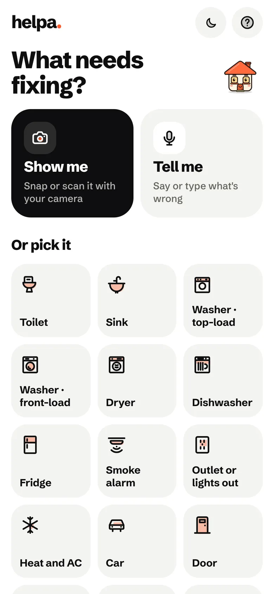
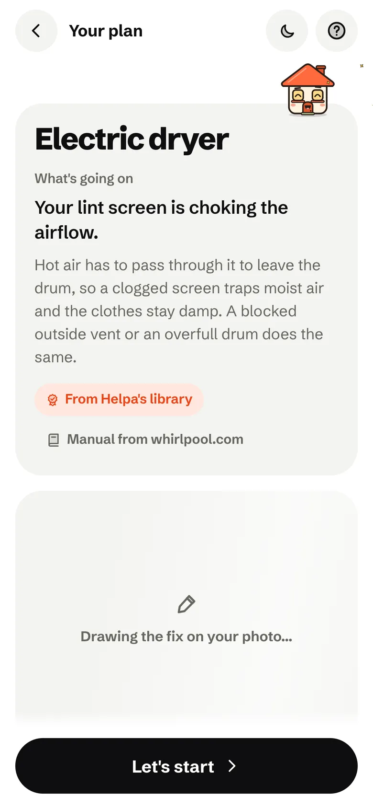
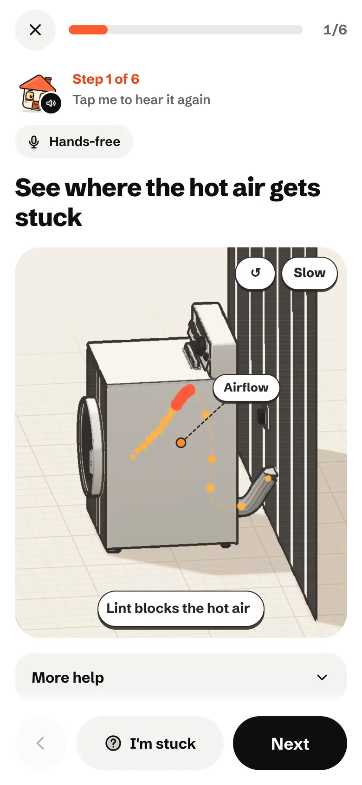
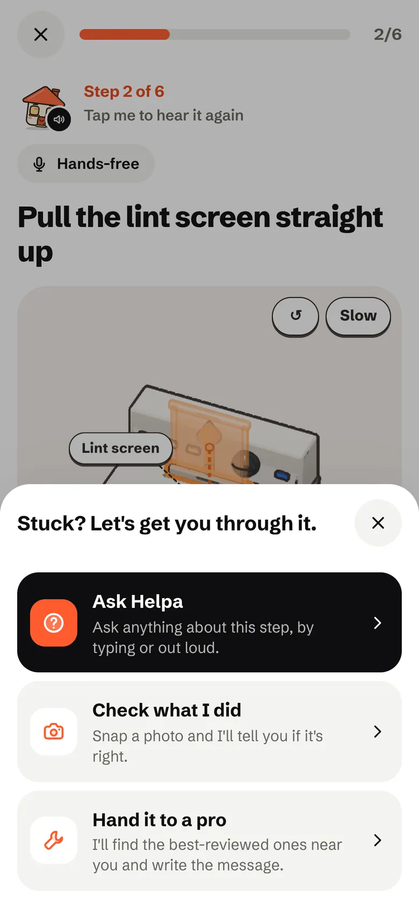
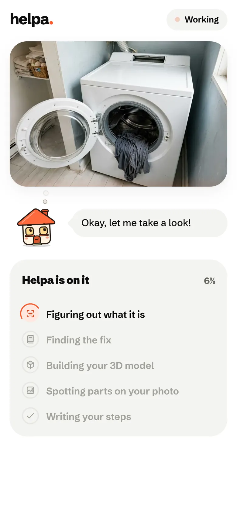
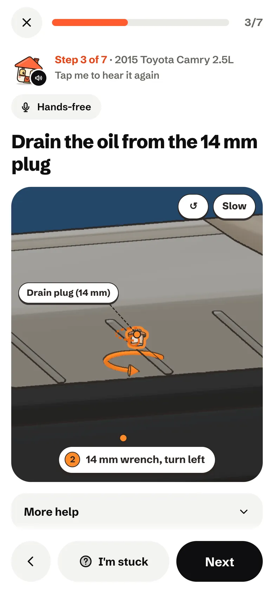
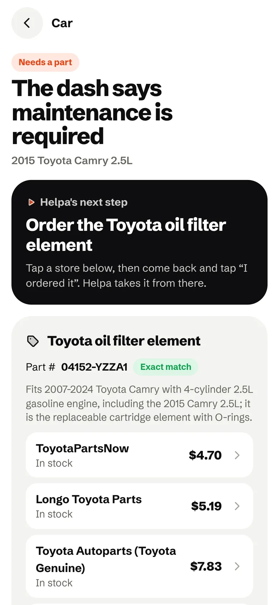
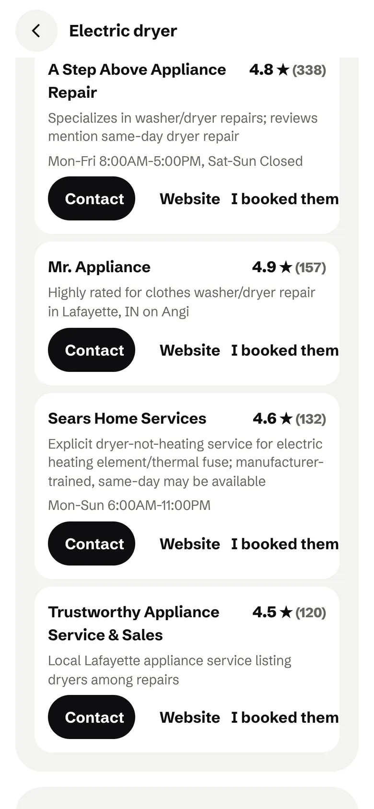
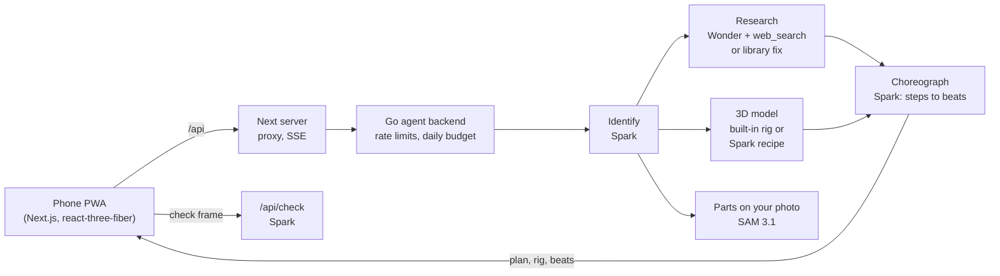

# Helpa

**Helpa understands how your machine works and guides your hands through fixing it.**

Point your phone at a broken dryer, dishwasher, toilet, sink, fridge or car, say what's wrong, or just pick it from a
list. Helpa reads the model sticker, researches that exact machine, and shows each move on a 3D model of it. Stuck? Ask
it anything by voice or text, or snap a photo of what you did and it tells you if you got it right. Simple enough for anyone: big buttons, every step read aloud, and "next" said out loud when your hands are full.

Built solo by Joey Kokinda ([@joeykokinda](https://github.com/joeykokinda)) for the Meta Global AI Developer Hackathon,
Indie Developer track. **Everything in this repo was written during the event**: kickoff was Mon Oct 26, 12:00 PM ET, and
the first commit is Oct 26, 4:13 PM ET. No earlier codebase, template or product. See
[What was built during the hackathon](#what-was-built-during-the-hackathon).

**Meta models:** Muse Spark, Muse Wonder, SAM 3.1, Muse Image and Muse Voice Transcribe, all live through the Meta Model
API. Muse Spark Open (open weights) is wired in for photo checks. Details in [Meta models](#meta-models).

**Try it:** https://helpa.pyras.org is the landing page (QR code, screenshots, a story clip); the app
itself is at https://helpa.pyras.org/app on any phone (Android Chrome or iPhone Safari). No account.
(Backup link to the same server: https://brach.taild3399f.ts.net.)

### Test it in 60 seconds

1. Open `/app`, and under **Or pick it** tap **Dryer**, then **Spins but no heat**. Helpa asks for a photo of your
   dryer or its sticker so the fix is for your exact model; with no dryer nearby, tap **No photo? Show the general
   fix**. The plan shows every step as a picture drawn from the 3D model.
2. Tap **Let's start** and watch the move in 3D. Then tap **I'm stuck**: **Ask Helpa** (type or talk) or
   **Check what I did** (snap a photo).
3. Tap **Still broken** until Helpa calls for a part, then **Find a pro near me** to open the job. Find the thermal
   fuse, tap **I ordered it** and type the tracking number **DEMO**: the order plays through shipped, out for
   delivery and delivered in 90 seconds (with a push notification if you turned them on).

Nothing broken? **Watch a fix** on the first screen replays recorded real runs (gritty dishes, clothes still wet,
disposal hums, washer won't drain, Camry oil change). Add it to your home screen to use it like an app.

| Pick it | The plan | 3D step | Stuck? |
|---|---|---|---|
|  |  |  |  |

| Agents working | Camry oil change | Exact part | Local pros |
|---|---|---|---|
|  |  |  |  |


## What it does

- **Show it, tell it, or pick it.** The first screen is three ways in: the camera, your voice, or a tile for every
  thing Helpa knows (16 things, 75 ready fixes, from a running toilet to a chirping smoke alarm). Picking a problem
  goes straight to its fix, no typing and no photo.
- **Circle it.** Draw on your own photo with a finger to show exactly where the problem is; the marked photo goes to
  Muse Spark. **Muse Image** then redraws your photo as a repair diagram, the part circled and the move drawn on,
  shown with the plan and used as your share card when it's fixed.
- **Jobs: from broken to fixed, on autopilot.** Every fix is a job with Helpa's next step on top. Needs a part?
  **Muse Wonder** searches the web for the exact part number for your model and where to buy it (only pages it
  actually found). Tap "I ordered it" and a background agent has **Muse Spark** check the tracking every few hours,
  then pushes a notification when it ships and when it arrives; tapping it opens the install guide for that part.
  Needs a pro? Muse Wonder finds the best-reviewed local pros for the right trade, and you call or text them with a
  message Helpa wrote: your machine, the likely cause, what's already ruled out, part numbers and the times you're
  free. Book it, add it to your calendar, and get a reminder the day before. Fixed jobs get a check-up reminder.
- **The plan in pictures.** Before you start, every step is drawn as a picture from the 3D model of your machine,
  the part in orange and the move on it, like a page of assembly instructions. Tap one to jump to that step.
- **I'm stuck.** The 3D guide leads. If it isn't enough, "I'm stuck" offers the next level of help: Ask Helpa (answers about your machine and that exact step, out
  loud), a photo check of what you did, or handing the job to a pro.
- **Hands-free.** Say "next", "back", "repeat" or "I'm stuck" while you work, or just ask a question
  ("which way does it turn?"); Helpa ignores its own voice.
- **Your exact machine.** Snap the model sticker or VIN, or just say what's wrong. Helpa reads the identity
  ("Whirlpool WED5050LW", "2015 Toyota Camry 2.5L"), pulls that model's manual and parts list, and asks a tap-to-answer
  question when it needs one.
- **A 3D twin with real joints.** Doors hinge, filters twist then lift, lint screens slide, drain plugs unscrew.
  Each step plays as beats on the model, with effects for what actually happens: air choking at a clogged lint
  screen, oil streaming into the pan, standing water draining.
- **Check what I did.** Snap a photo after a step and Helpa answers **COMPLETED** (moves on by itself),
  **INCOMPLETE** (a specific correction, like "that's the spray arm, the filter is the round cap below it") or
  **UNCERTAIN** (asks for a better angle). The animation finishing never counts as you finishing.
- **My Home.** Every fix saves the machine with its model, history, photos and care reminders (lint screen every
  load, Camry oil every 10,000 miles). **Ask Helpa** is a follow-up chat that knows that machine and what you did to it.
- **Safe by default.** Gas, mains wiring, refrigerant, airbags and anything sparking get "call a pro", every time.

## Meta models

| Model | What Helpa uses it for |
|---|---|
| `muse-spark-1.3` | Fast identification, choreographing plan steps onto rig parts, generating on-demand 3D recipes, step checks (COMPLETED / INCOMPLETE / UNCERTAIN), sticker and VIN reading, Ask Helpa |
| `muse-wonder-1.0` | The research agent for unknown problems: finds the manual, diagnoses, writes beginner steps, calls tools. Also the part finder and pro finder agents, and it researched the Whirlpool and Camry entries in the fix library and reviewed its own 3D animations (`tools/review_library.py`) |
| `sam-3.1` | Finds and highlights the parts from each step on your own photo, and finds the model sticker so Spark can read a tight crop. (Live locate on camera frames powers the AR prototype, not the shipped app) |
| `muse-voice-transcribe-1.0` | Describe the problem, or ask Helpa, out loud |
| `muse-image-1.0` | Redraws your own photo as a repair diagram (part circled, move drawn on) for the plan and the share card; the "Try a sample" photos |
| `muse-spark-open-1026` (open weights, Baseten) | Check what I did, run first on the open model when `BASETEN_API_KEY` is set, with Muse Spark as the fallback; the result says which model made the call (`backend/openweights.go`). Off on the live server until Baseten credits land |
| Hosted `web_search` | Manuals, exploded parts diagrams, specs (Camry: 0W-20, 4.6 qt with filter, 14 mm plug) |

## How it works



- **Parallel pipeline.** After a fast identification, research, the 3D model and part measuring run at the same time
  and stream to the phone as they land. Known fixes (8 library machines) skip research and arrive in about 3 to 5 s.
- **Hand-made recipe models.** Sink, toilet, fridge, smoke alarm, outlet and breaker panel, furnace and thermostat,
  shower head and door are recipes (`tools/build_home_fixes.py`), with their fixes' beats written alongside, so a
  picked fix plays in 3D with no model calls.
- **Rigs.** 8 hand-built models (top-vent dryer, dishwasher, front and top-load washers, range, over-the-range
  microwave, garbage disposal, car oil change), each with a catalog of parts, joints, actions, aliases and effects.
  The catalog is the one animation language for every 3D step.
- **On-demand models.** For anything else, Spark writes a declarative recipe (17 shapes, 31 materials, joints) from
  a per-category blueprint, validated and repaired before it renders.
- **Live Guide (AR prototype, not in the app).** SAM re-anchors about once a second; between updates the phone's motion sensors and small-patch
  matching keep the overlay attached. Slides use a cutout of the real part, hinges and twists a perspective plane
  around the pivot. When confidence drops the overlay fades instead of pointing at the wrong thing. If a part can't
  be found in about 4 s, Helpa asks you to tap it.
- **Budget and limits.** Per-visitor rate limits per endpoint and a daily Meta spend cap (`HELPA_DAILY_BUDGET_USD`,
  default $15). Past the cap Helpa says it's resting and plays a sample instead of failing.

## What was built during the hackathon

All of it. One person, one repo, 171 commits from Oct 26 (after kickoff) to Nov 4. `git log --reverse` shows the
order; roughly:

| When (ET) | What landed |
|---|---|
| Oct 26 (from 4 PM, after kickoff) | Spikes proving SAM 3.1 part masks and Muse Wonder manual research; the Go agent loop over SSE; the phone flow; the rig system with real joints; the first Whirlpool fix library, researched by Muse Wonder |
| Oct 27 | More hand-built rigs (range, microwave, washers, disposal, Camry oil change), Muse visual review of its own animations |
| Oct 28 | Try a sample, My Home and Ask Helpa, rate limits and daily budget, the 50-case eval, deploy, branching diagnosis and safety stops, pick-it home, circle it, Muse Image drawings, the open-weights check |
| Oct 29 | Jobs: part finder, pro finder, tracking watcher with Web Push; landing page; AR moved out of the main flow |
| Nov 1 to 4 | Fair price, reaching out to a pro, photo-first exact-model fixes, real-phone fixes, landing, demo video |

Not ours: open-source libraries (Next.js, React, three.js, react-three-fiber, the Go standard library), the Schibsted
Grotesk font (OFL), and facts from public manuals found by web search at runtime. The sample photos were generated
with Muse Image during the event.

## Evaluation

50 real repair problems through the live pipeline, graded by Muse Spark against expected outlines
([docs/EVAL.md](docs/EVAL.md)):

| | Result |
|---|---|
| Right appliance | 49 / 50 |
| Dangerous cases sent to a pro | 8 / 8, no dangerous instructions in any case |
| Expected key steps covered | 123 / 149 (83%) |
| Has a 3D model | 50 / 50 (36 built-in, 14 generated) |
| Time to a plan | median 12.5 s; library fixes 4.5 s |

Against plain Muse Spark as a chatbot (10 cases): about the same steps (28/30 vs 29/30), **3× less to read**
(214 vs 598 words), the first physical action on line 2 instead of line 6, and a 3D model of the machine. The
chatbot is faster on problems Helpa has to research (11 s vs about 22 s).

## Run it locally

```sh
# Backend. Free offline replay of recorded runs:
cd backend && HELPA_REPLAY=fixtures go run .
# Or live, with a Meta Model API key:
cd backend && META_API_KEY=... go run .

# App (proxies /api to the backend on 127.0.0.1:8095)
cd app && pnpm install && pnpm dev
```

`scripts/deploy-brach.sh` builds the backend and a standalone Next server and runs both as user services on the
host. `tools/eval/` reruns the evaluation; `tools/record_samples.py` re-records the samples.

## Layout

- `app/`: Next.js PWA (screens, Helpa, rigs, recipe renderer, Live Guide)
- `backend/`: Go API (pipeline, library, rigs, choreographer, live locate and checks, Ask, guard, replay)
- `tools/`: eval, sample recording, rig thumbnails, catalog sync, library review
- `docs/`: evaluation, video plan, submission notes
- `spike/`: the first-afternoon checks that SAM 3.1 and Muse Wonder could do the job
- `media/`: scripts that cut the demo video

## Known gaps

- The AR Live Guide (`app/components/LiveGuide.tsx`, dev page `/livepreview`) works but wasn't steady enough on real
  phones for the deadline, so the app uses the 3D guide plus photo checks instead.
- Library fixes cover the most common cause and don't branch to the next one yet. A known fix can override a
  detail that contradicts it ("coil burners" got the glass-top fix).
- Every car problem reuses the oil-change rig; the 3D car body is generic, only its engine bay is Camry-specific.
- SAM finds the model sticker reliably up close, not with the whole machine in view.
- The daily budget lives in memory and resets on restart.

## License

MIT, see [LICENSE](LICENSE).
