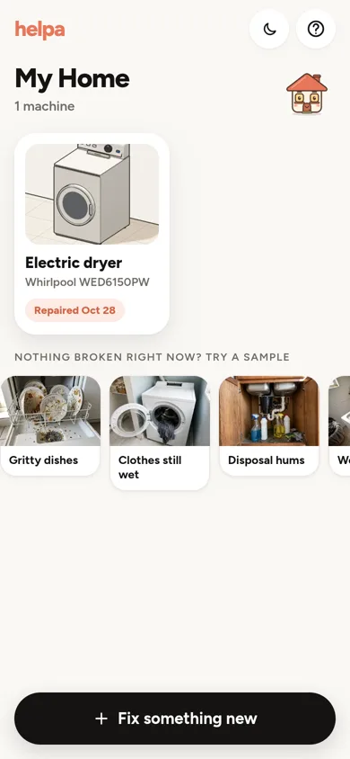
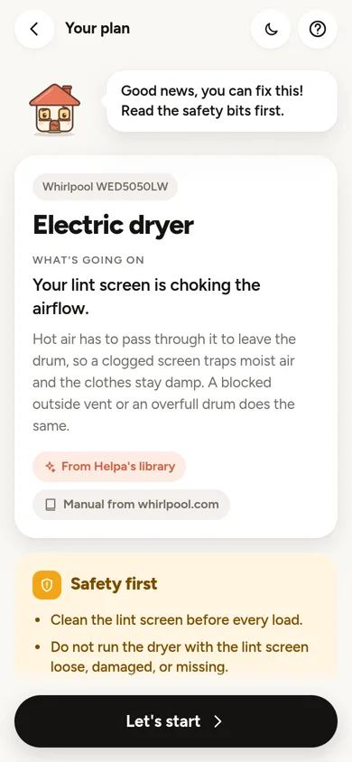
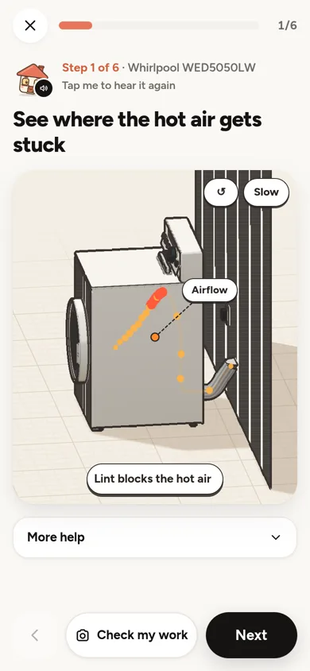
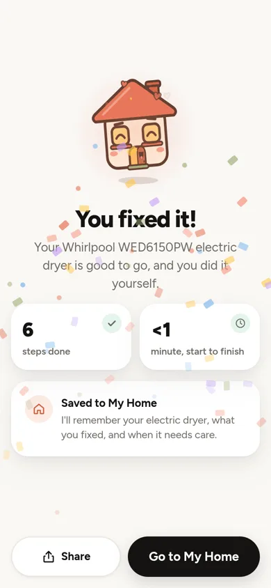
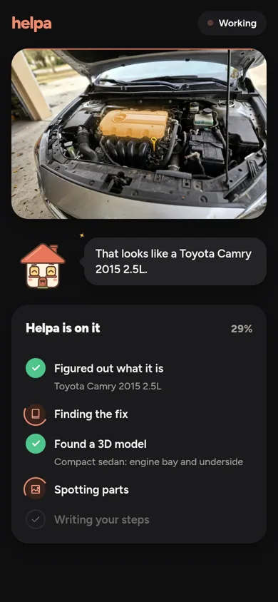
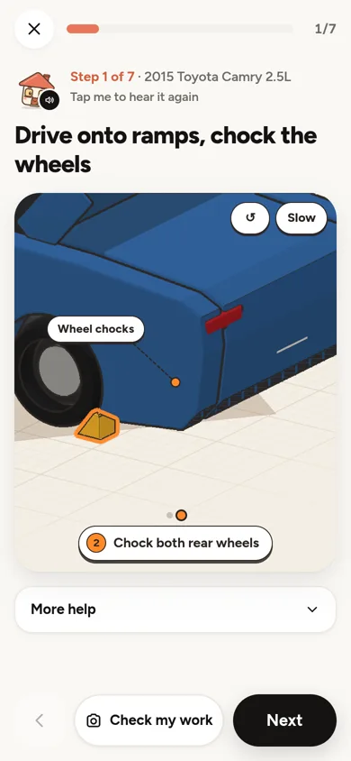
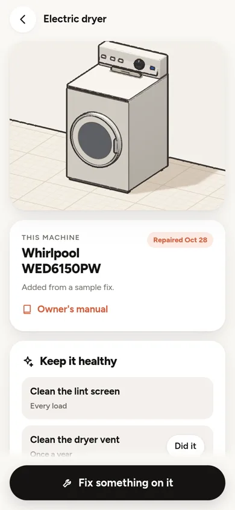
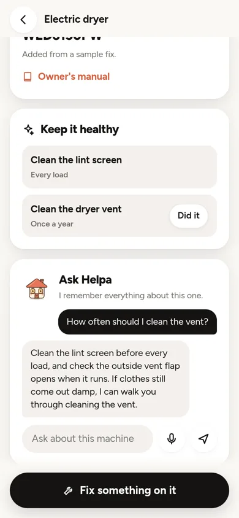
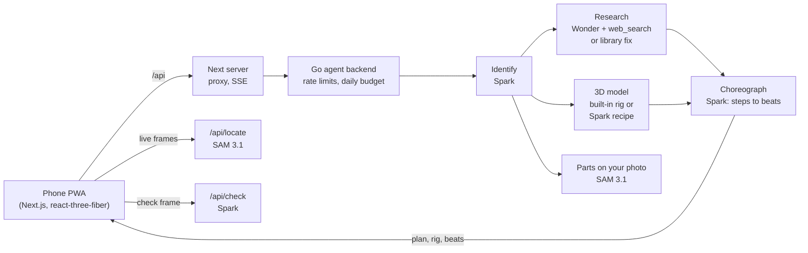

# Helpa

**Helpa understands how your machine works and guides your hands through fixing it.**

Point your phone at a broken dryer, dishwasher, disposal or car. Helpa reads the model sticker, researches that exact
machine, and shows each move on a 3D model of it. Then it plays the move as a hologram on your real machine through
the camera, watches you do it, and tells you when you got it right.

Built solo for the Meta Global AI Developer Hackathon (Oct 27 to Nov 4, 2026). Everything in this repo was written
during the hackathon.

**Try it:** https://brach.taild3399f.ts.net on any phone (Android Chrome or iPhone Safari). Nothing broken? Tap
**Try a sample** on the first screen (gritty dishes, clothes still wet, disposal hums, washer won't drain, Camry oil
change) for the full flow in about 30 seconds. Add it to your home screen to use it like an app.

| My Home | The plan | 3D step | Done |
|---|---|---|---|
|  |  |  |  |

| Agents working | Camry oil change | Machine page | Ask Helpa |
|---|---|---|---|
|  |  |  |  |

Live Guide recordings on real machines (to add): `docs/media/live-lint.mp4` (hologram lint screen on a real dryer),
`docs/media/live-oil.mp4` (oil stream from the Camry drain plug), `docs/media/sticker.mp4` (reading the model sticker).

## What it does

- **Your exact machine.** Snap the model sticker or VIN, or just say what's wrong. Helpa reads the identity
  ("Whirlpool WED5050LW", "2015 Toyota Camry 2.5L"), pulls that model's manual and parts list, and asks a tap-to-answer
  question when it needs one.
- **A 3D twin with real joints.** Doors hinge, filters twist then lift, lint screens slide, drain plugs unscrew.
  Each step plays as beats on the model, with effects for what actually happens: air choking at a clogged lint
  screen, oil streaming into the pan, standing water draining.
- **Live Guide (AR).** "Show me on my camera" finds the part on your live camera, locks onto it, and plays the move
  as a cyan hologram of your own part, with the 3D twin in the corner playing the same beat on the same clock.
- **Your turn.** After the demo, Helpa watches the real part and answers **COMPLETED** (moves on by itself),
  **INCOMPLETE** (a specific correction, like "that's the spray arm, the filter is the round cap below it") or
  **UNCERTAIN** (asks for a better angle). The animation finishing never counts as you finishing.
- **My Home.** Every fix saves the machine with its model, history, photos and care reminders (lint screen every
  load, Camry oil every 10,000 miles). **Ask Helpa** is a follow-up chat that knows that machine and what you did to it.
- **Safe by default.** Gas, mains wiring, refrigerant, airbags and anything sparking get "call a pro", every time.

## Meta models

| Model | What Helpa uses it for |
|---|---|
| `muse-spark-1.3` | Fast identification, choreographing plan steps onto rig parts, generating on-demand 3D recipes, step checks (COMPLETED / INCOMPLETE / UNCERTAIN), sticker and VIN reading, Ask Helpa |
| `muse-wonder-1.0` | The research agent for unknown problems: finds the manual, diagnoses, writes beginner steps, calls tools. It also built the 8-machine library of known fixes ahead of time |
| `sam-3.1` | Highlights parts on your photos; live locate on camera frames (up to 4 part names in parallel, cropped to where the part sits); point prompts when you tap a part; finds the model sticker |
| `muse-voice-transcribe-1.0` | Describe the problem, or ask Helpa, out loud |
| `muse-image-1.0` | The "Try a sample" photos |
| Hosted `web_search` | Manuals, exploded parts diagrams, specs (Camry: 0W-20, 4.6 qt with filter, 14 mm plug) |

## How it works



- **Parallel pipeline.** After a fast identification, research, the 3D model and part measuring run at the same time
  and stream to the phone as they land. Known fixes (8 library machines) skip research and arrive in about 3 to 5 s.
- **Rigs.** 8 hand-built models (top-vent dryer, dishwasher, front and top-load washers, range, over-the-range
  microwave, garbage disposal, car oil change), each with a catalog of parts, joints, actions, aliases and effects.
  The catalog is the one animation language: the 3D view and the AR overlay both read it.
- **On-demand models.** For anything else, Spark writes a declarative recipe (17 shapes, 31 materials, joints) from
  a per-category blueprint, validated and repaired before it renders.
- **Live Guide.** SAM re-anchors about once a second; between updates the phone's motion sensors and small-patch
  matching keep the overlay attached. Slides use a cutout of the real part, hinges and twists a perspective plane
  around the pivot. When confidence drops the overlay fades instead of pointing at the wrong thing. If a part can't
  be found in about 4 s, Helpa asks you to tap it.
- **Budget and limits.** Per-visitor rate limits per endpoint and a daily Meta spend cap (`HELPA_DAILY_BUDGET_USD`,
  default $15). Past the cap Helpa says it's resting and plays a sample instead of failing.

## Evaluation

50 real repair problems through the live pipeline, graded by Muse Spark against expected outlines
([docs/EVAL.md](docs/EVAL.md)):

| | Result |
|---|---|
| Right appliance | 49 / 50 |
| Dangerous cases sent to a pro | 8 / 8, no dangerous instructions in any case |
| Expected key steps covered | 123 / 149 (83%) |
| Has a 3D model | 50 / 50 (36 built-in, 14 generated) |
| Time to a plan | median 12.5 s; library fixes 4.5 s |

Against plain Muse Spark as a chatbot (10 cases): about the same steps (28/30 vs 29/30), **3× less to read**
(214 vs 598 words), the first physical action on line 2 instead of line 6, and a 3D model of the machine. The
chatbot is faster on problems Helpa has to research (11 s vs about 22 s).

## Run it locally

```sh
# Backend. Free offline replay of recorded runs:
cd backend && HELPA_REPLAY=fixtures go run .
# Or live, with a Meta Model API key:
cd backend && META_API_KEY=... go run .

# App (proxies /api to the backend on 127.0.0.1:8095)
cd app && pnpm install && pnpm dev
```

`scripts/deploy-brach.sh` builds the backend and a standalone Next server and runs both as user services on the
host. `tools/eval/` reruns the evaluation; `tools/record_samples.py` re-records the samples.

## Layout

- `app/`: Next.js PWA (screens, Helpa, rigs, recipe renderer, Live Guide)
- `backend/`: Go API (pipeline, library, rigs, choreographer, live locate and checks, Ask, guard, replay)
- `tools/`: eval, sample recording, rig thumbnails, catalog sync, library review
- `docs/`: evaluation, video plan

## Known gaps

- Live Guide is tested on recorded camera footage and in headless Chromium, not yet on a range of real phones.
- Library fixes cover the most common cause and don't branch to the next one yet. A known fix can override a
  detail that contradicts it ("coil burners" got the glass-top fix).
- Every car problem reuses the oil-change rig; the 3D car body is generic, only its engine bay is Camry-specific.
- SAM finds the model sticker reliably up close, not with the whole machine in view.
- The daily budget lives in memory and resets on restart.
